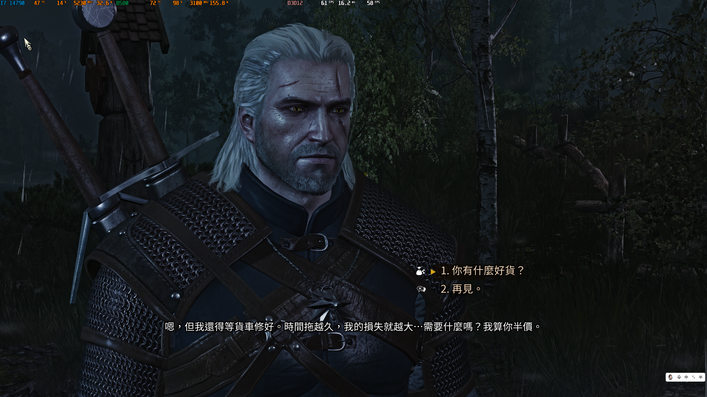
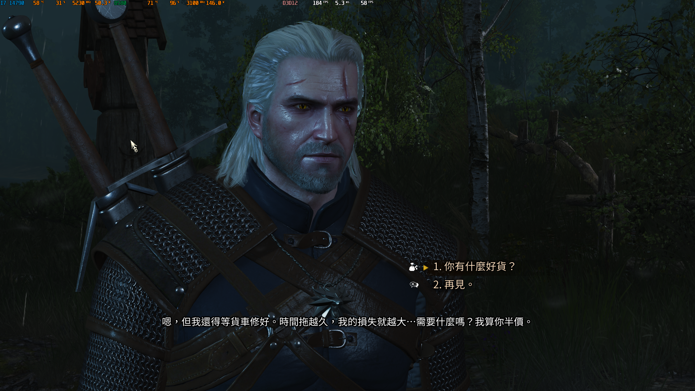
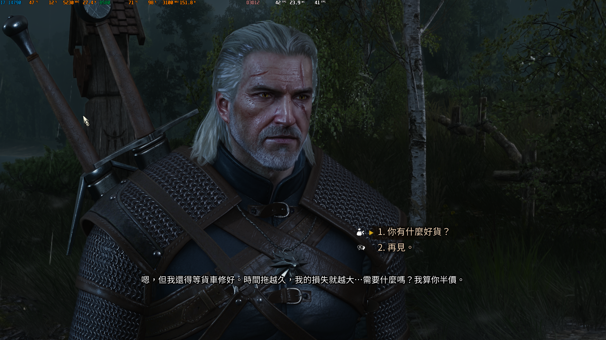

# Intel DLSS5 NR — DX12 Universal

**Latest archived pre-release: v0.7.2.** The unified installer uses `Setup.cmd` for installation and removal. Residual extrapolation has an off-by-default switch and a typed multiplier from 1 to 4. In-game verification of the updated controls is pending.

[Download v0.7.2](https://github.com/gggz114514-oss/intel-dlss5nr-dx12/releases/tag/archive-v0.7.2-controls) · [Iteration archive](docs/ITERATION-ARCHIVE.md) · [Source snapshots](https://github.com/gggz114514-oss/intel-dlss5nr-dx12/tree/archive/iterations-20261107)

The original v0.4.0 installation instructions follow.

**Vulkan NR Full / Small for Intel Arc, integrated into OptiScaler.** Used in Cyberpunk 2077, The Witcher 3 DX12, and Death Stranding Director’s Cut. Press **Insert** for the in-game OPT / Intel NR panel.

[Download complete installer](https://github.com/gggz114514-oss/intel-dlss5nr-dx12/releases/download/v0.4.0-dx12/Intel-NR-DX12-20261104.zip) · [v0.4.0 release](https://github.com/gggz114514-oss/intel-dlss5nr-dx12/releases/tag/v0.4.0-dx12) · [中文完整说明](README.zh-CN.md) · [Installation](INSTALL.md)

## Install

1. Download and fully extract **Intel-NR-DX12-20261104.zip**.
2. Exit the game. Run **Install.cmd**, then select the game executable.
3. Enable DLSS/upscaling in the game. Load a save, press **Insert**, and enable Intel NR.
4. To remove it, exit the game and run **Uninstall.cmd** from the same package. Original replaced files are restored; backups and user logs remain.

No preinstalled OPT, Python, Visual Studio or Vulkan SDK is required. Windows 10/11 x64 and an installed compatible Intel graphics driver are required; the measured platform is Arc B580. A missing VC++ x64 runtime is downloaded from Microsoft with signature verification.

Alternatively download the repository and run **Install-NR.cmd**. It downloads the pinned complete release, checks SHA256, and launches the same installer. Source-root uninstall and diagnostics entries are **Uninstall-NR.cmd** and **Collect-NR-Logs.cmd**.

| Game | Executable |
|---|---|
| Cyberpunk 2077 | `bin/x64/Cyberpunk2077.exe` |
| The Witcher 3 next-gen | `bin/x64_dx12/witcher3.exe` (DX12) |
| Death Stranding Director’s Cut | `ds.exe` |

Other game EXEs are accepted using a generic DX12 profile (`dxgi.dll`). Select the rendering executable, not a launcher. The three games above retain tested profiles. Generic games start with frame generation disabled; configure it separately after confirming NR works. Installation is not a compatibility certification. Export diagnostics with **Collect-Logs.cmd** if the hook does not load.

## Included

Optimized Full and Small; native variable-resolution input and 720/540/480/360p NR processing; matched OPT host, Vulkan runtime, model assets, FSR XMX and SR/FG dependencies. Native means the game’s render input, not display resolution. Settings live in OPT; there is no separate browser filter editor.

The Small runtime includes the tested **4 KiB alignment rule for buffers sized (4 KiB, 64 KiB]**. Natural style removes the overly dark legacy LUT, while Classic/Natural/Cinematic and strength controls remain. Defaults are Full/native/Classic, NVIDIA DXGI + Streamline spoofing inside the game process, and XeFG output. Cyberpunk/Witcher require the in-game frame-generation switch; Death Stranding uses upscaler FG input. Existing INI preferences win.

Files are verified before installation and backed up individually. **Do not manually delete native game FidelityFX DLLs.** The installer restores replaced files on uninstall. Complete binaries are Release assets; Git contains source, tools and manifests. [Third-party notices](LICENSES.md).

## Special thanks: two AMD community projects

- **[mochizuki0323 / DLSSNR-AMD (望月)](https://github.com/mochizuki0323/DLSSNR-AMD)**: model unpacking, network organization, producer/consumer layouts and input-processing reference for the Vulkan backend.
- **[TheAutomatic / dlss-5-amd-project](https://github.com/TheAutomatic/dlss-5-amd-project)**: the OptiScaler host, game input contracts, submission/resource lifetime and panel integration used as the base of this universal bridge.

Their licenses remain distinct: MIT for the Mochizuki source, GPL-3.0 for the derived OPT host, and each dependency’s own terms. This is a community project, with no AMD/Intel/NVIDIA endorsement. [Attribution](docs/optimization/AMD-ATTRIBUTION.md).

## The Witcher 3 comparison

User-confirmed order: **Small → NR off → Full**, with **frame generation disabled in all three**. Original PNGs are preserved without resizing or color processing. Compare skin, hair and armor; the instantaneous FPS overlay is not a paired benchmark.

### Small

### NR off

### Full

## Performance history

Arc B580, 1280×720 NR input:

| Measurement | Result |
|---|---|
| Full historical starting point → optimized head | **50.821 → 17.450 ms** |
| Latest Full paired campaign | **18.724 → 17.450 ms** |
| Optimized Small paired batch | **14.324 → 9.980 ms** |

These are historical NR inference measurements. Input resolution and workload affect timings. [Full optimization history](docs/optimization/FULL-HISTORY.md).

## Development and diagnostics

[Source/build instructions](docs/DX12-DEVELOPMENT.md) · [Small GPU-hang investigation](docs/optimization/SMALL-GPU-HANG-20261103.md) · [Package identities](docs/releases/20261103-package-manifest.json) · [Other-game integration](PORTING.md) · [Experiment tools](tools/experiments/README.md) · [Recovery](docs/RECOVERY.md) · [Index](docs/INDEX.md)

Run **Collect-Logs.cmd** to export diagnostics locally. Review the archive before sharing it; include GPU/driver, game, model, NR resolution and reproduction steps. No automatic upload, saves or captured frames are included.
