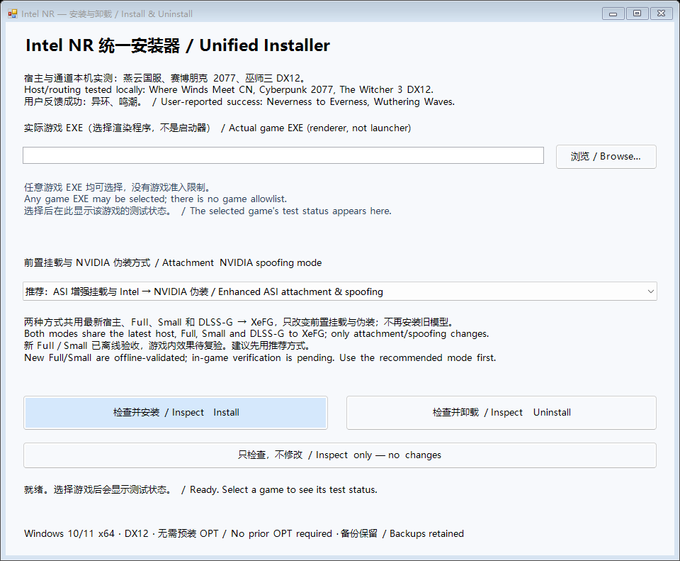

# Intel DLSS5 NR — DX12 通用

Intel Arc 上的 Vulkan NR Full／Small，集成于 OptiScaler。当前预发行版为 **v0.7.2**，安装包含 FSR XMX 与补帧依赖。

[下载 v0.7.2 ZIP](https://github.com/gggz114514-oss/intel-dlss5nr-dx12/releases/download/archive-v0.7.2-controls/Intel-NR-Unified-v0.7.2-controls.zip) · [本版说明](https://github.com/gggz114514-oss/intel-dlss5nr-dx12/releases/tag/archive-v0.7.2-controls) · [English](README.md)

## 安装与卸载

1. 完整解压 ZIP，退出游戏。
2. 双击 **Setup.cmd**，选择实际 DX12 渲染 EXE。默认使用增强 ASI 挂载，也可选择内置伪装。两种方式共用宿主和模型。
3. 选择「检查并安装」，阅读确认提示后继续。卸载时在同一窗口选择「检查并卸载」。完成窗口会显示 `intel-nr-backups` 下的本次备份和日志目录。
4. 启动游戏并开启超分，按 **Insert** 打开 Intel NR 菜单。

需要 Windows 10/11 x64 和兼容的 Intel 显卡驱动，实测硬件为 Arc B580。[完整安装指南](INSTALL.md)

| 游戏 | 选择的渲染程序 |
| --- | --- |
| 燕云国服 | `Engine/Binaries/Win64rh/yysls.exe` |
| 赛博朋克 2077 | `bin/x64/Cyberpunk2077.exe` |
| 巫师三次世代版 | `bin/x64_dx12/witcher3.exe` |

此前宿主与接入通道在上述三款游戏中实测通过。其他 DX12 游戏也可选择。v0.7.2 已通过宿主构建和安装器检查，新控件的游戏内效果待复验。

## NR 设置

可选 Full／Small，处理分辨率可用原生、720p、540p、480p 或 360p。默认 Full、原生、经典。勾选「启用残差外推」后输入 **1–4 倍**并按回车。新配置预填 2 倍，默认关闭。保存设置可记住开关和倍率。

安装包包含配套宿主、Vulkan 运行库、模型资源及超分和补帧依赖。[第三方许可证](LICENSES.md)

## 版本与源码

归档记录各版安装包、对应源码材料和验收状态。仓库根目录的 `Install-NR.cmd` 使用固定的 v0.4.0 安装包。

[版本索引](docs/ITERATION-ARCHIVE.md) · [源码归档](https://github.com/gggz114514-oss/intel-dlss5nr-dx12/tree/archive/iterations-20261107) · [v0.4.0 发布页](https://github.com/gggz114514-oss/intel-dlss5nr-dx12/releases/tag/v0.4.0-dx12)

## 特别鸣谢 AMD 社区的两个项目

- **[望月 / mochizuki0323 — DLSSNR-AMD](https://github.com/mochizuki0323/DLSSNR-AMD)**：模型解包、网络组织、生产消费布局、矩阵之间的交接与输入处理为本 Vulkan 后端提供了重要基础。
- **[TheAutomatic — dlss-5-amd-project](https://github.com/TheAutomatic/dlss-5-amd-project)**：OPT 通用宿主、游戏输入合同、提交／资源生命周期和面板集成是本次通用桥的重要参考与源码基础。

这是社区项目之间的借鉴与移植，不代表 AMD／Intel／NVIDIA 官方产品。望月 MIT、OPT 派生宿主 GPL-3.0 及各第三方许可证分别保留，见 [许可证与来源](LICENSES.md) 和 [详细致谢](docs/optimization/AMD-ATTRIBUTION.md)。

## v0.7.2 安装器实图

巫师三的 Small／NR 关闭／Full 三张游戏截图摄于 v0.4.0 时期，均关闭补帧。v0.7.2 的游戏画面待复验。[历史截图](https://github.com/gggz114514-oss/intel-dlss5nr-dx12/blob/eaf0ce5acab9cc51b4e02bb06a0ac9480cab5225/README.zh-CN.md#巫师三实机对比)

## v0.7.2 所用模型的离线验收

Arc B580、1280×720 NR 输入。下表记录 11 月 6 日各模型与其各自上一版本的配对 GPU 计时。

| 模型 | 含历史处理 | 标准 GPU 区段 |
| --- | --- | --- |
| Full 封存版 `62d438f6` | 15.0367 → 15.0030 ms | 14.9603 → 14.9961 ms |
| 随包 Small `3b35fb14` | 10.3179 → 8.9284 ms | 10.1643 → 8.9208 ms |

随包 Full 为旧 CRT 兼容构建 `7fc56d5a`。五组 35 帧输出与封存版逐位一致，兼容构建的性能待单独测速。表中数值为离线 GPU 区段计时，游戏帧率待实测。原始报告随 ZIP 提供，位于 `VALIDATION/FP16-Next`。[v0.7.2 发布页](https://github.com/gggz114514-oss/intel-dlss5nr-dx12/releases/tag/archive-v0.7.2-controls)

## 开发、排障与恢复

- [DX12 宿主源码、固定上游及构建](docs/DX12-DEVELOPMENT.md)
- [Small 挂死：完整排查、修复与经验笔记](docs/optimization/SMALL-GPU-HANG-20261103.md)
- [当前安装包 SHA-256 与源码](docs/ITERATION-ARCHIVE.md)
- [实验工具](tools/experiments/README.md)、[恢复说明](docs/RECOVERY.md)、[文档索引](docs/INDEX.md)

故障时运行 **Collect-Logs.cmd**（源码入口为 `Collect-NR-Logs.cmd`），检查生成的 ZIP 后反馈。日志不会自动上传，不含存档或采集帧。请附游戏、显卡、驱动、后端、输入分辨率和复现动作。
